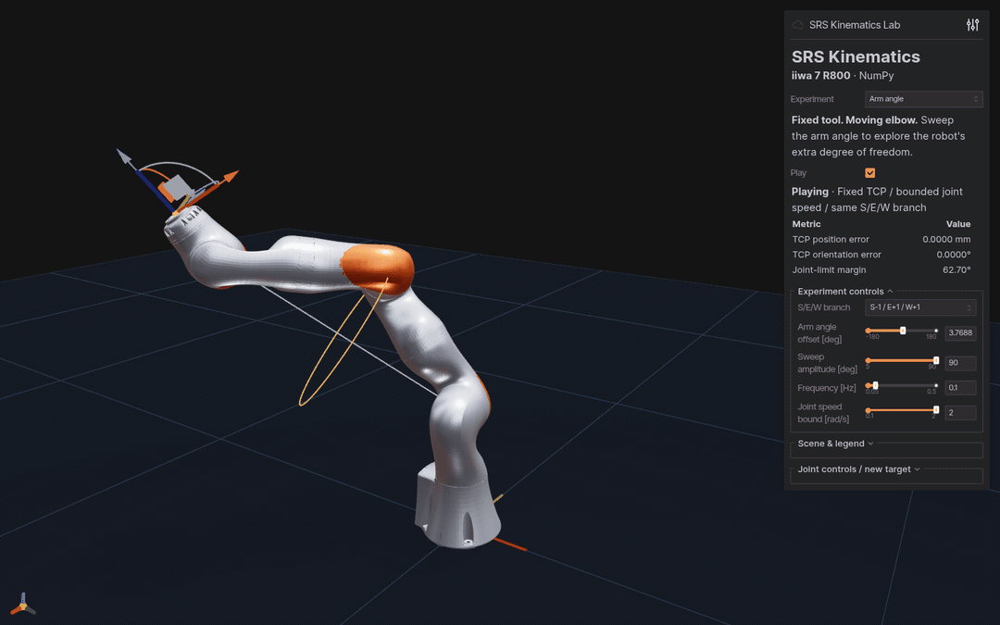
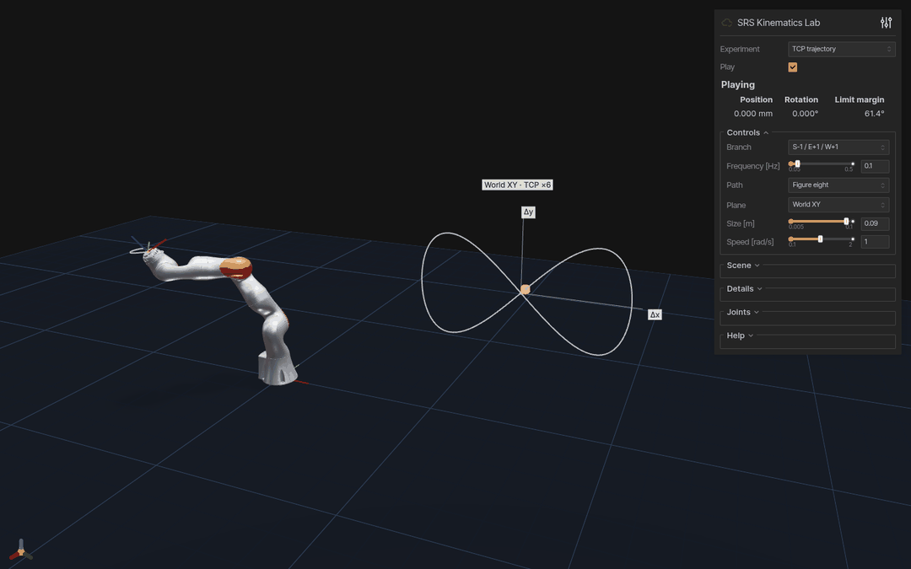

# 7DofSRSKinematics

English | [简体中文](README_ZH.md) · [Warp version](https://github.com/chase6305/7DofSRSKinematicsWarp)

NumPy analytical kinematics for 7-DoF S-R-S arms, with a KUKA iiwa 7 R800 example.

- Analytical FK / IK, eight S/E/W branches and arm-angle control.
- Batched link poses, Jacobians and null-space motion.
- Interactive demos and CSV export.

## Demos

### Fixed-TCP self-motion · ±90° arm-angle sweep



### Figure-eight TCP tracking · 180 × 90 mm



Two ten-second recordings of the running viewer.

## Quick start

Python 3.8+:

```bash
python -m pip install -e '.[visualization]'
srs-viser-lab --demo arm-angle --amplitude 90 --joint-speed 2 --autoplay
# Or run the figure-eight demo:
srs-viser-lab --demo trajectory --path-size 0.09 --autoplay
```

Open <http://127.0.0.1:8081>. Select an experiment and toggle **Play**.
The sidebar also offers eight branches, a Jacobian ellipsoid and the self-motion
manifold. [Controls and CSV export](docs/demos.md).

## Python API

```python
import numpy as np
from kuka_iiwa_solver import KUKAiiwaSolver

solver = KUKAiiwaSolver()
target = solver.get_fk(np.array([0.3, -0.5, 0.7, 1.0, -0.4, 0.8, -0.2]))
ok, joints = solver.get_ik(target, np.zeros(7), num_samples=73)
if ok:
    print(joints)  # radians
```

[API reference](docs/api.md) covers batch shapes, frames and limits.

## Benchmark

4096 poses on one Ryzen 9 9950X CPU thread, NumPy 2.2.6:

| Operation | Median latency |
| --- | ---: |
| FK | 1.272 ms |
| All link poses | 1.840 ms |
| Jacobian | 1.806 ms |

Warmed batch calls, including input validation.
[Raw results](docs/benchmarks/batch-chain.json).

## References

- Shimizu et al. (2008). [Analytical Inverse Kinematic Computation for 7-DOF
  Redundant Manipulators With Joint Limits and Its Application to Redundancy
  Resolution](https://doi.org/10.1109/TRO.2008.2003266).
  *IEEE Transactions on Robotics*, 24(5), 1131–1142.
- Faria et al. (2018). [Position-based kinematics for 7-DoF serial manipulators
  with global configuration control, joint limit and singularity
  avoidance](https://doi.org/10.1016/j.mechmachtheory.2017.10.025).
  *Mechanism and Machine Theory*, 121, 317–334.

The arm-angle core supports sampled and joint-boundary search. The papers’
redundancy/avoidance policies and experiments are not fully reproduced.
See [implementation differences](docs/paper-comparison.md).
