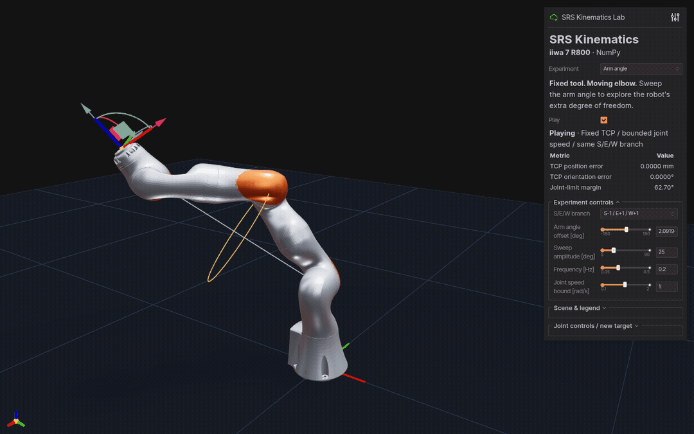

# 7DofSRSKinematics

[中文](README.md) | English · [Warp backend](https://github.com/chase6305/7DofSRSKinematicsWarp)

NumPy analytical kinematics for 7-DoF S-R-S arms, with a bundled KUKA iiwa 7 R800.



Fixed-TCP self-motion → figure-eight tracking. Ten seconds of actual NumPy playback.

- Analytical FK / IK, eight shoulder/elbow/wrist branches and continuous arm-angle control.
- Batched FK, exact configuration solves, analytical Jacobians and null-space motion.
- NumPy-only core; optional interactive experiments and packaged robot assets.

## Run the demo

```bash
python -m pip install -e '.[visualization]'
srs-viser-lab --autoplay
```

Open **http://127.0.0.1:8081**. Select an Experiment, toggle Play, or drag the
TCP gizmo to choose a target. Live metrics show actual pose error and limit margin.

| Experiment | What to watch |
|:--|:--|
| Arm angle | Elbow motion with a fixed TCP |
| Eight branches | Eight S/E/W robot configurations side by side |
| Jacobian | Velocity ellipsoid and fixed-TCP joint centering |
| TCP trajectory | Line, circle and figure-eight references versus actual FK |
| Self-motion manifold | Fixed-TCP branches projected into joint space |

Try `srs-viser-lab --demo trajectory --autoplay`.
[Controls, screenshots and CSV export →](docs/demos.md)

## Python API

For the solver alone: `python -m pip install -e .`.

```python
import numpy as np
from kuka_iiwa_solver import KUKAiiwaSolver

solver = KUKAiiwaSolver()
target = solver.get_fk(np.array([0.3, -0.5, 0.7, 1.0, -0.4, 0.8, -0.2]))
ok, joints = solver.get_ik(target, np.zeros(7), num_samples=73)
if ok:
    print(joints)  # (7,), radians
```

Continuous search prefers the seed's nearby configuration. Use
`search_mode="global"` to enumerate arm-angle samples; finite sampling may miss
feasible intervals. [Batch APIs and numerical conventions →](docs/api.md)

## Documentation and validation

- [Experiments and recordings](docs/demos.md) · [API](docs/api.md)
- [Tests, benchmarks and backend comparison](docs/development.md) · [Contributing](CONTRIBUTING.md)
- [R800 assets, PBR finishes and the iiwa14 reference](docs/assets.md) · [Asset license](urdf/ASSET_LICENSE)

```bash
python -m pip install -e '.[test]'
python -m pytest -q
srs-viser-lab --validate-only
```
