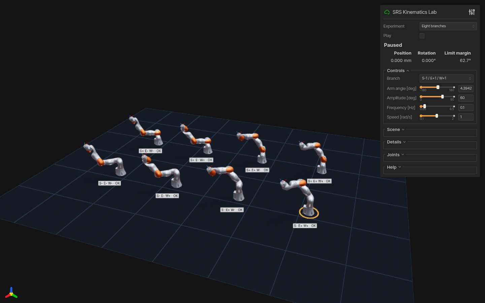
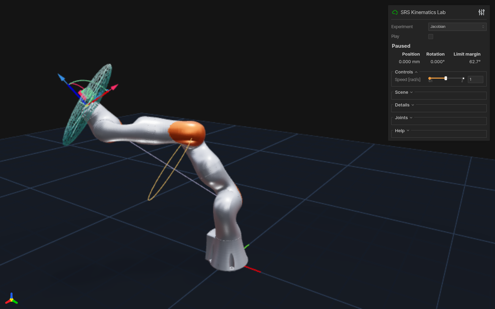
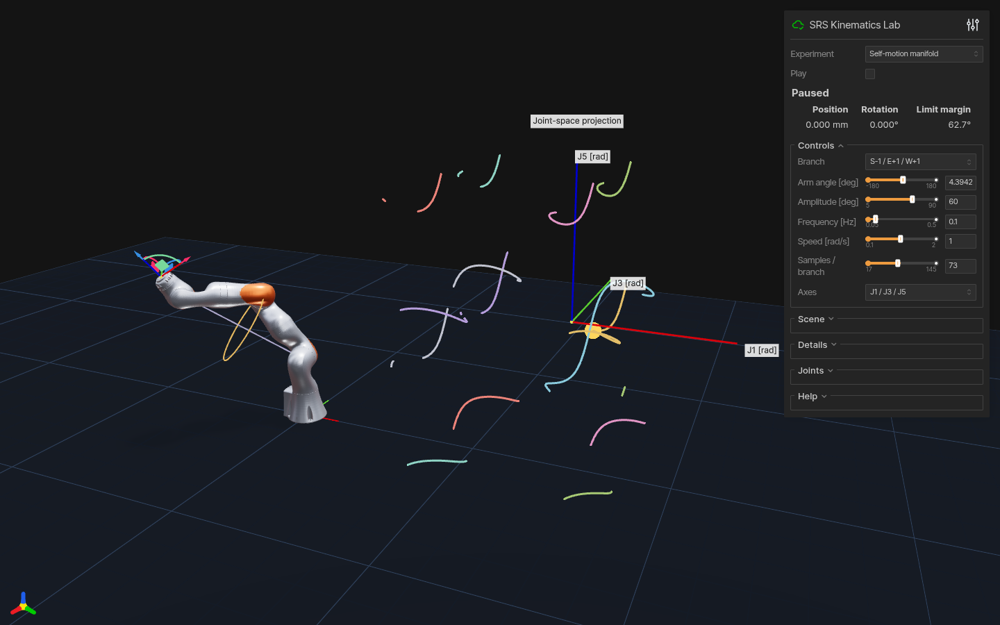

# Interactive experiments

Install `.[visualization]`, then open `http://127.0.0.1:8081` after launching:

```bash
srs-viser-lab --demo arm-angle
```

Select an experiment in the page or with `--demo`:

| Mode | Experiment |
| :-- | :-- |
| `arm-angle` | Fixed-TCP self-motion, shoulder/elbow/wrist markers and the geometric elbow circle. |
| `branches` | Eight S/E/W configurations with availability and joint-limit margins. Display tiles share one local target and arm angle. |
| `jacobian` | Linear velocity ellipsoid and joint centering corrected back to the fixed TCP. |
| `trajectory` | Fixed-orientation line, circle or figure-eight tracking: gray reference, green FK trace. |
| `manifold` | Eight fixed-TCP branches projected into three joint coordinates, with infeasible intervals and large jumps broken. |

## Reproduce the two README demos

```bash
srs-viser-lab --demo arm-angle --amplitude 90 --frequency 0.1 --joint-speed 2 --autoplay
srs-viser-lab --demo trajectory --path figure-eight --plane world-xy --path-size 0.09 --frequency 0.1 --joint-speed 1 --autoplay
```

The [self-motion GIF](media/self-motion.gif) sweeps ±90°; the
[tracking GIF](media/trajectory.gif) covers 180 × 90 mm. Both are ten-second
recordings of the running R800 app, captured at 15 fps after fixed simulation
steps at 30 Hz. The [capture manifest](media/capture.json) records each backend,
pose residuals, speed, limits and loop closure. Playback is not a throughput
benchmark.

## Controls and interpretation

Play pauses/resumes without losing phase. **Joints**, **Preset** and the
TCP gizmo choose a new target; pause before dragging the gizmo. **Scene**
toggles meshes, guides and joint labels. **Reset view** affects your own browser.
**Help** contains the color legend and experiment notes; **Details** contains branch
tables and additional diagnostics.
`--no-mesh` keeps the geometric skeleton; `--port` changes the port. The server
binds to `127.0.0.1` by default.

Automatic playback respects **Speed** using direct joint changes.
It reduces progress near constraints and pauses at the last feasible pose if
no valid step remains. Actual frequency can be below the reference frequency.
Manual pose selection is immediate. Changing pose, branch, arm angle, amplitude
or experiment resets the sweep; pause/resume preserves it.

Trajectory planes are world XY/XZ/YZ or TCP-local XY at the path's start.
Changing path, plane or size starts from the current TCP. Path size is circle
radius, half the line length or half the figure-eight width; figure-eight height
equals its size. The right plot magnifies displacement six times. Defaults are
a ±60° sweep or 0.05 m path size at 0.1 Hz, with a 1 rad/s joint-speed bound.

The elbow circle is geometric: joint limits can exclude parts of it. The
velocity ellipsoid shows translation for unit joint-speed norm at display scale
0.25, **with orientation unconstrained**; self-motion uses the full `6×7`
Jacobian. Joint centering is local descent. Manifold coordinates are joint angles
in radians at display scale 0.22; projected crossings need not be identical
seven-joint poses. **Samples / branch** sets finite sampling resolution, which
can miss narrow feasible intervals.

## Headless validation and CSV

```bash
srs-viser-lab --validate-only --validation-frames 40
srs-viser-lab --demo trajectory --plane tool-xy --path circle --path-size 0.015 --frames 300 --fps 30 --export-csv trajectory.csv
```

These commands need no visualization dependencies. Validation checks all five
experiments, limits, separate position/rotation residuals and centering descent.
CSV works in every mode and contains the initial pose and accepted steps:
simulated time, seven joints, actual/target TCP positions and rotations, pose
errors, limit margin, peak joint speed, phase, arm angle and S/E/W branch.
Units are meters, radians and seconds; rotation matrices are flattened by row.
`--fps` accepts 20–240 and export advances by fixed `1/fps` steps. Early pauses
retain accepted rows and exit with code 2 and a JSON reason. Existing files are
preserved; validation and CSV export are mutually exclusive.

`python examples/viser_demo.py` now opens this same lab. Its legacy numerical
benchmark remains available without viewer dependencies:

```bash
python examples/viser_demo.py --validate-only --validation-samples 100 --search-mode global
```

It uses a fixed random seed and perturbed IK seeds; `--search-mode continuous`
selects the local search. `examples/null_space_demo.py` provides a terminal-only
arm-angle sweep.

## Other recorded views

| Eight S/E/W branches | Jacobian null space | Self-motion manifold |
| :-- | :-- | :-- |
|  |  |  |
