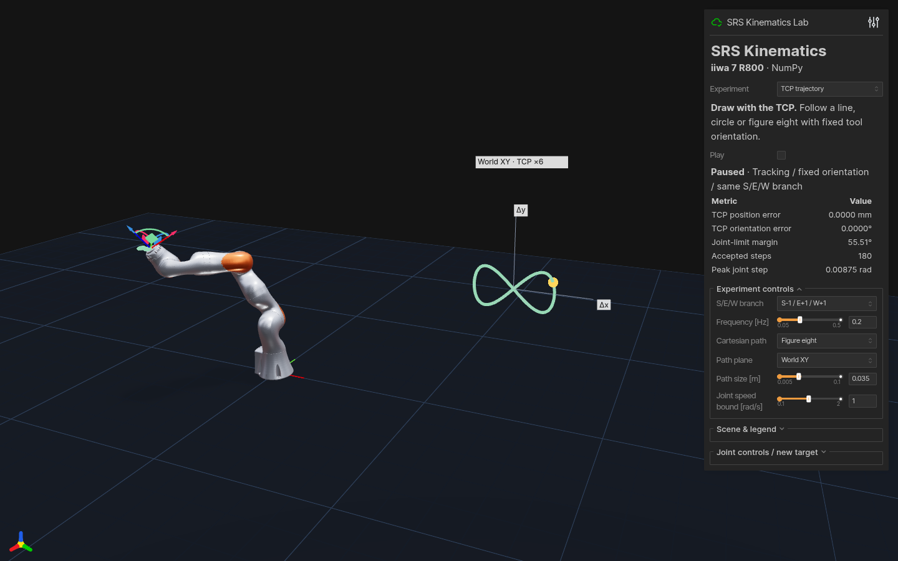

# Interactive experiments

The SRS lab provides five experiments, also selectable from the Experiment menu:

```bash
python examples/viser_srs_lab.py --demo arm-angle --port 8081
python examples/viser_srs_lab.py --demo branches --port 8082
python examples/viser_srs_lab.py --demo jacobian --port 8083
python examples/viser_trajectory_demo.py --port 8084
python examples/viser_manifold_demo.py --port 8085
```

After installing `.[visualization]`, the same options are available through `srs-viser-lab`. Both repositories pin their visualization extras to the verified Viser 1.0.24 release.

| Mode | Experiment |
|:--|:--|
| `arm-angle` | Sweep the arm angle at a fixed TCP, with shoulder/elbow/wrist markers, the shoulder–wrist axis and geometric elbow circle. Infeasible angles retain the last feasible pose and display a message. |
| `branches` | Compare eight S/E/W branches, availability and minimum joint-limit margin. Tiles are translated for display; their local target and arm angle are identical. |
| `jacobian` | Inspect the linear velocity ellipsoid and joint-centering preference. Play projects centering velocity into the full Jacobian null space and corrects each step back to the exact TCP target. |
| `trajectory` | Follow a line, circle or figure eight with fixed TCP orientation and S/E/W branch. Gray is the reference and green is the FK trace, with error and maximum joint-step metrics. |
| `manifold` | Sample all eight fixed-TCP self-motion branches and project them onto J1/J3/J5. Infeasible samples and large joint jumps break the curves; a marker tracks the current configuration. |

Trajectory controls select the path, plane, size and joint-speed bound. Path plane offers world XY/XZ/YZ and TCP-local XY, using the TCP orientation at the start. Changing the path, plane or size starts a new reference from the current TCP. Progress slows near constraints and pauses at the last feasible pose when no valid step remains. Frequency is a reference value: actual progress may be slower. Pause to drag the TCP gizmo. The right plot magnifies displacement along the selected plane axes by six.

All automatic playback modes respect Joint speed bound using direct joint differences per frame, without wrapping away full turns. Up to 12 progressively halved steps let fast arm-angle sweeps and slow Cartesian paths reduce progress before pausing with the last feasible pose and phase intact. Self-motion playback stops at failed steps instead of continuing its sweep to a distant feasible angle. Manual joint, branch and arm-angle controls select poses directly; changing sweep amplitude recenters playback at the current arm angle.

Pausing and resuming preserves the sweep phase, center and direction. Pose, branch, arm-angle, amplitude or experiment changes start a new sweep.

The CLI also accepts `--path`, `--plane`, `--path-size`, `--preset`, `--frequency`, `--joint-speed` and `--amplitude`. Export reproducible playback without installing Viser:

```bash
python examples/viser_trajectory_demo.py --plane tool-xy --path circle --path-size 0.015 --autoplay
python examples/viser_trajectory_demo.py --plane world-xz --path circle --path-size 0.015 --frames 300 --fps 30 --export-csv trajectory.csv
python examples/viser_manifold_demo.py --frames 300 --fps 30 --export-csv self_motion.csv
```

CSV includes the initial pose and each accepted step: simulated time, seven joint angles, actual/target world TCP positions and rotation matrices, pose errors, joint-limit margin, peak joint speed, phase, arm angle and S/E/W branch. Positions are in meters, angles in radians, and matrices are flattened by row. `--fps` accepts 20–240; export uses fixed simulation time steps of `1/fps`, independent of computation time. All five modes export the selected robot. Early pauses retain accepted rows and return exit code 2 with a reason in the JSON report. Existing files are preserved; `--validate-only` and `--export-csv` are mutually exclusive.

Projection axes switches the manifold between J1/J3/J5, shoulder J1/J2/J3, wrist J5/J6/J7 and J2/J4/J6. Curves update only when the target, sampling resolution or projection changes; playback updates the current marker.

Manifold resolution is controlled by Samples / branch. Its coordinates are joint angles in radians, rendered at scale 0.22; crossings in the projection need not be the same seven-joint configuration. Finite sampling may miss narrow feasible intervals. The arm-angle slider and Play move the robot and current joint-space marker together.

`solve_configurations(target, configurations, seed)` exposes the batched exact IK used for manifold sampling. It returns a `(N,)` boolean mask and `(N, 7)` joints in input order; invalid rows are zero and must be masked. Geometry is prepared once per elbow branch and arm-angle evaluation and FK checks are batched.

Drag the TCP gizmo to set a new target, or use joint sliders and Pose preset to reset the pose. Play starts arm-angle sweeps or joint centering. `--autoplay` starts playback; `--no-mesh` shows only the geometric skeleton. The server binds to `127.0.0.1` by default. Paused idle scenes do not recompute or redraw.

Consecutive drag samples from one control are coalesced on insertion. Different controls, reset and mode changes preserve their order so coalescing cannot silently change the TCP target. Rendering and diagnostics share link poses; self-motion reuses the previous frame's Jacobian. Branch IK and link poses are cached by target and arm angle. Automatic stops immediately refresh the final status.

The orange circle is geometric: joint limits can exclude parts of it. The velocity ellipsoid represents translational velocity for unit joint-speed norm, rendered at scale 0.25, **with orientation unconstrained**. Actual self-motion uses the full `6×7` Jacobian. Centering is a local descent example on the current target and branch, without a global optimality guarantee.

All five numerical experiments can be checked without visualization dependencies. Validation checks limits, separate position/rotation residuals and a decreasing centering objective, and exits nonzero on failure:

```bash
python examples/viser_srs_lab.py --validate-only --validation-frames 40
```

The original FK/IK performance dashboard is also available:

```bash
python examples/viser_demo.py --port 8080
```

Viser uses the fast continuous mode by default; pass `--search-mode global` to compare exhaustive search.

Open `http://localhost:8080`. Joint sliders drive FK; dragging the orange TCP gizmo runs IK. The Null-space motion panel animates arm-angle self-motion while keeping the TCP fixed. The dashboard displays the active branch, arm angle, residual, solve time, rolling update FPS, and startup benchmark median/p95 latency.

Headless validation requires only NumPy and uses the selected search mode:

```bash
python examples/viser_demo.py --validate-only --validation-samples 100
python examples/viser_demo.py --validate-only --validation-samples 100 --search-mode global
```

It uses a fixed random seed and perturbed joint seeds, reports successes, median/p95 latency and pose residuals, and exits with a nonzero status if any solve fails.

Arm-angle/null-space sweep with a fixed TCP:

```bash
python examples/null_space_demo.py --samples 25 --range-deg 35
```

## Scene controls

The compact panel keeps Play and live TCP error visible. Experiment controls
change with the selected mode; pose presets and individual joints are under
**Joint controls / new target**. Open **Scene & legend** to toggle meshes,
geometry guides and joint labels, or reset your camera. **Reset view** affects
only your own browser; mode changes frame the new experiment for all clients.
The eight-branch view loads its robot meshes on first use; hidden or unavailable
branches do not display a robot. `--no-mesh` keeps the geometry-only view.

Fixed trajectory reference lines are built when the path changes. During
playback only the actual trace and current marker are rebuilt. Changing the
path, plane, size, pose or TCP immediately rebuilds the reference.

## Recorded views

These are captures of the running Viser app with the bundled R800 model.

| Eight S/E/W branches | Cartesian tracking |
|:--|:--|
|  |  |

| Jacobian null space | Self-motion manifold |
|:--|:--|
|  |  |


The [capture manifest](media/capture.json) records the backend, Viser version,
simulation rate, pose residuals and joint-speed bound for the actual recording.
The ten-second GIF joins two five-second recordings: a 25° fixed-TCP arm-angle
sweep, then figure-eight TCP tracking at 0.2 Hz. Both run at 15 fps and the GIF
loops; it is not a measurement of solver or rendering throughput. Still images
are 1440×900. The manifest records both sections and their measured residuals.

Scene visibility is refreshed after experiment or display edits. Playback
updates the moving geometry; hidden branch robots are not toggled every frame.
